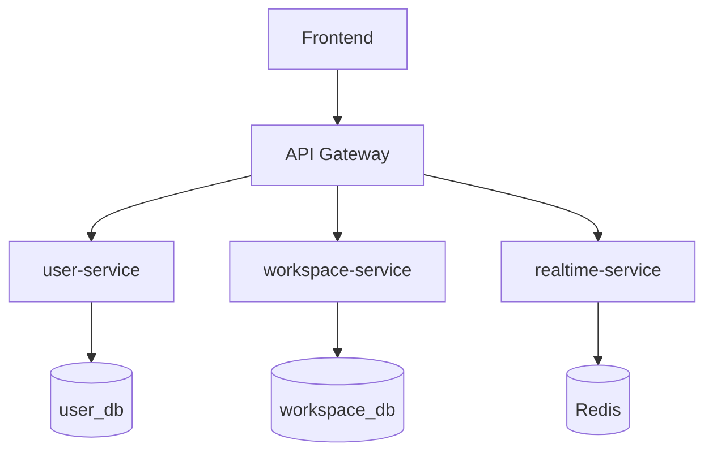

Твоя задача - провести глибокий аналіз усього репозиторію NoteSpace та створити масштабовану knowledge base для майбутньої роботи Codex.

Головна мета - не просто створити документацію для людини.

Головна мета - створити довготривалий технічний контекст, який дозволить майбутнім сесіям Codex:

* швидко зрозуміти ідею NoteSpace;
* розуміти поточну архітектуру;
* розуміти межі мікросервісів;
* знати, що вже реалізовано;
* знати, що тільки заплановано;
* правильно додавати нові features;
* правильно додавати нові microservices;
* не порушувати існуючі architectural boundaries;
* знати ownership даних;
* розуміти API та service contracts;
* знати основні business/domain rules;
* розуміти security architecture;
* знаходити потрібний код без повторного аналізу всього repository;
* масштабувати систему новими технологіями без переписування основної business logic.

Документація також повинна бути зручною для відкриття як Obsidian Vault.

---

# 1. Product Context

NoteSpace - collaborative workspace / note-taking application.

Основна концепція:

```text
User
  ↓
Workspace / Room
  ↓
Members + Roles + Permissions
  ↓
Documents
  ↓
Collaborative Editing
```

Користувач повинен мати можливість:

* зареєструватися;
* авторизуватися;
* створювати робочі простори / rooms;
* приєднуватися до них;
* запрошувати інших користувачів;
* мати різні ролі та permissions;
* створювати документи;
* редагувати документи;
* працювати над документами одночасно з іншими користувачами;
* бачити presence інших користувачів;
* надалі отримувати notifications та використовувати інші сервіси.

За продуктовою ідеєю NoteSpace схожий на поєднання:

* Notion-style workspace;
* Google Docs-style realtime collaboration.

Не використовуй ці продукти як технічні requirements. Це лише контекст для розуміння domain.

---

# 2. Current Roadmap

Зафіксуй наступний roadmap як PRODUCT DIRECTION.

Дуже важливо:

Не описуй заплановану функціональність як уже реалізовану.

Чітко розрізняй:

* IMPLEMENTED
* IN PROGRESS
* PLANNED

Поточний roadmap:

## PHASE 1 - AUTH

```text
✅ Registration
⬜ Login
⬜ JWT
⬜ Refresh tokens
⬜ Spring Security
⬜ /users/me
⬜ Logout
⬜ Validation
⬜ Global exceptions
⬜ Unit tests
⬜ Integration tests
```

Основний сервіс:

`user-service`

---

## PHASE 2 - WORKSPACES / ROOMS

```text
⬜ Room / Workspace entity
⬜ RoomMember entity
⬜ Create room
⬜ Update room
⬜ Delete room
⬜ Join room
⬜ Leave room
⬜ Invite users
⬜ Roles
⬜ Permissions
```

---

## PHASE 3 - DOCUMENTS

```text
⬜ Document entity
⬜ Create document
⬜ Edit document
⬜ Delete document
⬜ Document permissions
⬜ Tiptap editor
```

---

## PHASE 4 - REALTIME

```text
⬜ WebSocket
⬜ Redis
⬜ Yjs
⬜ Collaborative editing
⬜ Online users
⬜ Presence
⬜ Typing indicator
```

---

## PHASE 5 - EVENT-DRIVEN EXTENSIONS

Future direction:

```text
⬜ Message broker
⬜ Domain events
⬜ Integration events
⬜ Notification service
⬜ Event contracts
⬜ Outbox pattern if required
```

Message broker is NOT currently a mandatory dependency.

Do not introduce Kafka, RabbitMQ or another broker unless existing code already uses it.

Document only the extension points where event-driven communication could later be introduced.

---

## PHASE 6 - PRODUCTION

```text
⬜ Docker
⬜ Docker Compose
⬜ GitHub Actions
⬜ API Gateway
⬜ Nginx / edge routing if required
⬜ HTTPS
⬜ Logging
⬜ Monitoring
⬜ Health checks
⬜ Deployment
```

Again:

PLANNED != IMPLEMENTED.

---

# 3. Architectural Direction

NoteSpace should be designed so additional microservices can be added later.

Current and future architecture should follow these principles unless existing code explicitly contradicts them.

## Service autonomy

Each microservice should own a clear business capability.

Examples of potential boundaries:

```text
user-service
    identity
    authentication
    credentials
    profile
```

Potential future service:

```text
workspace-service
    workspaces / rooms
    membership
    roles
    permissions
    document metadata / document lifecycle
```

Potential future service:

```text
realtime-service
    WebSocket
    collaborative sessions
    Yjs
    presence
    online users
    realtime synchronization
```

Potential future service:

```text
notification-service
    email
    push / in-app notifications
    processing integration events
```

These are architectural directions, NOT requirements to create these services now.

Do not create empty microservices.

---

# 4. Database Ownership

Design documentation around the principle:

```text
one service owns its data
```

Future model may look like:

```text
user-service
     ↓
user_db


workspace-service
     ↓
workspace_db


notification-service
     ↓
notification_db
```

A service must not directly access another service's database.

Communication should happen through explicit contracts:

```text
REST / HTTP
```

or later:

```text
integration events / message broker
```

Document actual current implementation separately from this architectural rule.

---

# 5. Technology Independence

Business logic should not unnecessarily depend directly on infrastructure technology.

Prefer conceptual boundaries such as:

```text
Business Logic
      ↓
Port / Interface
      ↓
Infrastructure Adapter
```

Possible future example:

```text
DomainEventPublisher
        ↓
KafkaEventPublisher
```

instead of:

```text
BusinessService
        ↓
KafkaTemplate
```

Another possible example:

```text
PresenceStore
      ↓
RedisPresenceStore
```

instead of spreading direct Redis access through domain/application logic.

Do NOT create abstractions only for theoretical purity.

Document this as an architectural guideline for future components.

---

# 6. Analyze the Repository First

Before creating documentation, inspect the complete repository.

Determine:

* repository structure;
* existing services;
* languages;
* frameworks;
* Maven/Gradle/npm configuration;
* infrastructure;
* Docker configuration;
* CI/CD;
* database configuration;
* existing API contracts;
* current service boundaries;
* current domain model;
* security;
* tests;
* environment variables;
* migrations;
* integrations.

Then perform a deeper analysis of:

`services/user-service/**`

For `user-service`, inspect at minimum:

* `pom.xml`;
* application entry point;
* application configuration;
* package structure;
* controllers;
* services;
* repositories;
* entities;
* DTOs;
* enums;
* validators;
* Spring Security configuration;
* authentication;
* JWT-related code;
* filters;
* exception handling;
* Flyway migrations;
* PostgreSQL configuration;
* tests;
* Actuator;
* environment variables.

Do not document assumptions when information can be checked in code.

---

# 7. Evidence Rule

There are two categories of information.

## CURRENT IMPLEMENTATION

Must be verified from source code/configuration.

Examples:

```text
Spring Boot version
REST endpoints
database tables
JWT implementation
classes
methods
validation
dependencies
```

## PLANNED ARCHITECTURE

Comes from project roadmap and architectural direction.

Always clearly mark it as:

`Planned`

or:

`Future direction`

Never mix these two categories.

---

# 8. Root Knowledge Base

Create:

```text
docs/context/
```

with approximately this structure:

```text
docs/context/
├── INDEX.md
├── PRODUCT.md
├── ROADMAP.md
├── ARCHITECTURE.md
├── SERVICE-CATALOG.md
├── DATA-OWNERSHIP.md
├── COMMUNICATION.md
├── CONVENTIONS.md
├── NEW-SERVICE.md
└── DECISIONS.md
```

Do not create meaningless or empty documents.

If two small documents are better combined, combine them.

---

# 9. Root INDEX.md

`docs/context/INDEX.md` is the primary navigation map.

Keep it compact.

Include:

```text
[[PRODUCT]]
[[ROADMAP]]
[[ARCHITECTURE]]
[[SERVICE-CATALOG]]
[[DATA-OWNERSHIP]]
[[COMMUNICATION]]
[[CONVENTIONS]]
[[NEW-SERVICE]]
[[DECISIONS]]
```

Also include:

## Context routing

Create a table similar to:

| Task                            | Read                                                     |
| ------------------------------- | -------------------------------------------------------- |
| Understand product              | PRODUCT, ROADMAP                                         |
| Change system architecture      | ARCHITECTURE, DECISIONS                                  |
| Add microservice                | NEW-SERVICE, ARCHITECTURE, DATA-OWNERSHIP, COMMUNICATION |
| Modify existing service         | SERVICE-CATALOG + service AGENTS.md                      |
| Add inter-service communication | COMMUNICATION                                            |
| Change database ownership       | DATA-OWNERSHIP                                           |
| Introduce message broker        | COMMUNICATION, ARCHITECTURE, DECISIONS                   |

Goal:

A future Codex should not need to read every document for every task.

---

# 10. PRODUCT.md

Explain the domain model of NoteSpace.

Focus on concepts, not implementation.

Describe:

```text
User
Workspace / Room
Membership
Role
Permission
Document
Collaborative Session
Presence
```

Explain relationships.

For example conceptually:

```text
User
  │
  │ Membership
  ▼
Workspace
  │
  ├── Members
  │
  └── Documents
```

Clearly distinguish domain concepts that are already implemented from planned concepts.

Document open terminology questions.

For example:

If current source code calls the domain `Room`, but future domain may be better represented as `Workspace`, record this ambiguity.

Do not rename source code automatically.

---

# 11. ROADMAP.md

Store the roadmap from this prompt.

For every phase specify:

* objective;
* current status;
* expected domain capability;
* likely affected service;
* dependencies on previous phases.

Keep status explicit.

Example:

```text
Phase 1
Status: IN PROGRESS

Phase 2
Status: PLANNED
```

Update this document when roadmap status changes.

---

# 12. ARCHITECTURE.md

Document two views.

## Current Architecture

Derived only from actual repository.

Show current services, databases and dependencies.

## Target Direction

Describe extensible future architecture.

Potential conceptual diagram:



Do NOT show planned services as implemented.

Label them clearly.

Also document core architectural invariants:

```text
Services own their data.
No cross-service database access.
Business logic stays inside owning service.
Infrastructure technologies should not leak unnecessarily into domain logic.
Inter-service communication uses explicit contracts.
```

---

# 13. SERVICE-CATALOG.md

Create a catalog of all current services.

Format:

| Service | Status | Responsibility | Database | Port | Context |
| ------- | ------ | -------------- | -------- | ---- | ------- |

For current `user-service`, fill information from actual configuration.

For planned services, use a separate section:

## Planned services

Never put planned services in the current-service table.

---

# 14. DATA-OWNERSHIP.md

Create an authoritative data ownership map.

Example structure:

| Data          | Owner        | Other services access through |
| ------------- | ------------ | ----------------------------- |
| User identity | user-service | API/event                     |
| Credentials   | user-service | Never exposed directly        |

Only document implemented ownership as fact.

Planned ownership must be marked.

Also establish the rule:

```text
A microservice must never read or modify another microservice's database directly.
```

If current repository violates this rule, document the violation instead of silently hiding it.

---

# 15. COMMUNICATION.md

Document actual communication between services.

Separately describe future communication patterns.

## Synchronous

Potential:

```text
HTTP / REST
```

## Asynchronous

Future possibility:

```text
Message Broker
Domain Events
Integration Events
```

Explain distinction between realtime collaboration and business events.

Realtime document synchronization should conceptually use:

```text
WebSocket
Yjs
Redis where required
```

Do not propose sending each editor operation through Kafka/RabbitMQ merely because a broker exists.

Message brokers should be reserved for appropriate asynchronous cross-service events such as:

```text
UserRegistered
UserInvitedToWorkspace
DocumentCreated
DocumentDeleted
```

These are conceptual examples.

Do not claim an event exists until implemented.

---

# 16. CONVENTIONS.md

Create repository-wide conventions based on actual code plus explicit architecture rules from this prompt.

Include:

* service naming;
* directory structure;
* API conventions;
* database ownership;
* migration conventions;
* configuration;
* environment variables;
* testing expectations;
* dependency injection;
* error handling;
* documentation maintenance.

Keep rules concise.

Avoid generic Java tutorials.

---

# 17. NEW-SERVICE.md

This document is very important for scalability.

It should tell a future Codex how to add a microservice to NoteSpace.

Include checklist:

## Before creating a service

1. Define business capability.
2. Confirm capability does not belong to existing service.
3. Define data ownership.
4. Define API/integration contracts.
5. Define dependencies.
6. Define whether communication is synchronous or asynchronous.
7. Avoid shared database access.

## Service structure

Use existing repository conventions.

Expected conceptual structure:

```text
services/<service-name>/
├── AGENTS.md
├── README.md
├── build file
├── Dockerfile           # when containerization exists
├── src/
└── docs/context/
```

Do not require files that current project does not yet use.

## After creation

Update:

```text
docs/context/SERVICE-CATALOG.md
docs/context/ARCHITECTURE.md
docs/context/DATA-OWNERSHIP.md
docs/context/COMMUNICATION.md
```

and root `AGENTS.md` when necessary.

---

# 18. DECISIONS.md

Record architectural decisions.

Use compact ADR-like format.

For example:

```text
## ADR-001 - Service-owned databases

Status: Accepted

Decision:
Each microservice owns its persistence model.

Reason:
Avoid coupling services through database schema.

Consequences:
Cross-service data must be obtained through explicit contracts.
```

Only mark decisions from this prompt or clearly established project choices as accepted.

For uncertain questions use:

```text
Status: Open
```

Do not invent historical reasoning.

---

# 19. Create Root AGENTS.md

Create:

`AGENTS.md`

in repository root.

This is NOT an encyclopedia.

Keep it compact.

Its purpose is:

* give Codex immediate understanding of NoteSpace;
* establish critical invariants;
* route Codex to deeper context.

Suggested structure:

```text
# NoteSpace

Collaborative workspace and realtime document editing platform.

## Product model

User -> Workspace/Room -> Membership -> Documents -> Collaboration

## Repository

services/        microservices
docs/context/    system-level agent knowledge

## Current state

Phase 1 AUTH is in progress.
Only functionality verified in source code should be treated as implemented.

## Core architecture rules

- Each service owns a business capability.
- Each service owns its data.
- Never access another service's database directly.
- Keep cross-service contracts explicit.
- Keep business logic independent from infrastructure where practical.
- Do not introduce infrastructure technologies without an actual requirement.
- Do not treat roadmap items as implemented features.

## Context

Read docs/context/INDEX.md to locate system context.

## Service work

Before modifying a service:

1. Read that service's AGENTS.md.
2. Read the relevant service context documents.
3. Check system-level architecture when the change crosses service boundaries.

## Documentation maintenance

When a change affects:
- architecture
- service responsibility
- API contract
- data ownership
- security
- database schema
- important business flow
- integration contract

update the corresponding context document.

Do not update context for trivial internal refactoring that changes no documented behavior.
```

Adapt paths/names to actual repository.

---

# 20. user-service Knowledge Base

After completing the system context, deeply document:

`services/user-service`

Create:

```text
services/user-service/docs/context/
```

Expected structure:

```text
INDEX.md
SERVICE.md
ARCHITECTURE.md
DOMAIN.md
API.md
SECURITY.md
DATABASE.md
FLOWS.md
CONVENTIONS.md
TESTING.md
KNOWN-ISSUES.md
```

Combine documents if appropriate.

---

# 21. user-service INDEX.md

Create navigation optimized for Codex.

Example:

| Task                  | Read                      |
| --------------------- | ------------------------- |
| Authentication change | SECURITY, FLOWS           |
| REST endpoint change  | API, ARCHITECTURE         |
| User/domain change    | DOMAIN                    |
| DB change             | DATABASE, DOMAIN          |
| Business logic        | FLOWS, DOMAIN             |
| Tests                 | TESTING                   |
| Refactoring           | ARCHITECTURE, CONVENTIONS |

---

# 22. user-service SERVICE.md

Document:

* responsibility;
* non-responsibilities;
* technology stack;
* Java version;
* Spring Boot version;
* important dependencies;
* runtime port;
* database;
* environment variables;
* important paths;
* application entry point.

Everything must come from actual code/configuration.

---

# 23. user-service ARCHITECTURE.md

Map:

```text
Controller
    ↓
Service
    ↓
Repository
    ↓
PostgreSQL
```

or actual architecture if different.

List important classes:

| Class | Responsibility | Depends on | Used by | Source |
| ----- | -------------- | ---------- | ------- | ------ |

Focus on important components.

Do not document every getter/setter/DTO as a separate component.

Add a change-impact map.

Example:

```text
Changing user persistence may affect:
- Entity
- Flyway migration
- Repository
- DTO mapping
- Service
- Tests
```

Adapt to actual implementation.

---

# 24. user-service DOMAIN.md

Document actual entities and domain rules.

For every important entity include:

* source path;
* table;
* fields;
* constraints;
* relationships;
* lifecycle;
* relevant business rules.

Create:

## Domain invariants

For every invariant show enforcement point.

Example:

```text
Email must be unique.

Enforced by:
- database constraint
- UserRepository.exists...
- RegistrationService...
```

Only if actually true.

---

# 25. user-service API.md

Inventory all REST endpoints:

| Method | Path | Auth | Request | Response | Controller | Service |
| ------ | ---- | ---- | ------- | -------- | ---------- | ------- |

For important endpoints document execution:

```text
HTTP
 ↓
Controller.method()
 ↓
Service.method()
 ↓
Repository.method()
 ↓
Database
```

Include validation and errors.

Do not invent endpoints planned in ROADMAP.

For example, if Login is not implemented yet, do NOT document `/login` as existing.

---

# 26. user-service SECURITY.md

Document actual security implementation.

Cover only features that exist:

* Spring Security configuration;
* AuthenticationManager;
* PasswordEncoder;
* JWT;
* filters;
* SecurityContext;
* public routes;
* protected routes;
* roles;
* authorities;
* refresh token handling;
* logout behavior.

If some parts are planned but absent, explicitly write:

```text
Status: PLANNED
```

Do not write standard Spring Security theory.

Focus on this repository.

Never copy actual secrets.

---

# 27. user-service DATABASE.md

Treat Flyway migrations as persistence schema source of truth when applicable.

Document:

* PostgreSQL;
* schemas/tables;
* migrations;
* constraints;
* indexes;
* foreign keys;
* JPA mapping;
* repository mapping.

Compare:

```text
Flyway
↔
JPA entities
```

Record mismatches in `KNOWN-ISSUES.md`.

---

# 28. user-service FLOWS.md

Document implemented end-to-end flows.

For registration, for example:

```text
HTTP request
 ↓
Controller
 ↓
Validation
 ↓
Service
 ↓
Repository
 ↓
PostgreSQL
 ↓
Response
```

Use exact class and method names.

When other roadmap features are implemented later, add:

* login;
* refresh;
* `/users/me`;
* logout.

Do not create fake flows for unimplemented features.

---

# 29. user-service CONVENTIONS.md

Infer actual coding conventions.

Focus on:

* package organization;
* constructor injection;
* service boundaries;
* DTO usage;
* validation;
* exceptions;
* transactions;
* repository access;
* migrations;
* tests;
* logging.

If repository is inconsistent, document the inconsistency.

---

# 30. user-service TESTING.md

Document:

* existing tests;
* testing stack;
* unit tests;
* integration tests;
* database testing;
* security testing;
* commands to run tests.

Do not claim coverage numbers without a report.

Document important gaps.

---

# 31. user-service KNOWN-ISSUES.md

Only evidence-based findings.

Use:

```text
Issue:
Evidence:
Affected files:
Impact:
```

Possible categories:

```text
Architecture
Security
Database
Maintainability
Testing
TODO/FIXME
```

Do not modify implementation in this task.

---

# 32. Create services/user-service/AGENTS.md

Create a short:

`services/user-service/AGENTS.md`

It should provide local instructions/context.

Important:

Root Codex sessions may not automatically use nested service instructions depending on the working directory.

Therefore root `AGENTS.md` must explicitly tell future agents:

```text
Before editing files inside services/<service>/,
read services/<service>/AGENTS.md.
```

Local file should contain:

```text
# user-service

Purpose:
Identity, user account and authentication service.

Current status:
Derived from actual code.

## Read first

docs/context/INDEX.md

## Before authentication work

Read:
- docs/context/SECURITY.md
- docs/context/FLOWS.md

## Before database/domain work

Read:
- docs/context/DOMAIN.md
- docs/context/DATABASE.md

## Before API changes

Read:
- docs/context/API.md

## Rules

Only include rules verified from code or root architecture documentation.
```

Keep it short.

---

# 33. Future Service Context Pattern

Document that every sufficiently complex future microservice should eventually have:

```text
services/<service>/
├── AGENTS.md
└── docs/context/
```

But do not generate documentation for services that do not exist.

The purpose is consistency, not empty scaffolding.

---

# 34. Source References

Technical documents must regularly point to real repository paths.

Example:

```text
Source:
`services/user-service/src/main/java/.../UserService.java`
```

Prefer:

```text
Class -> responsibility -> dependency -> source
```

over long prose.

Never reference nonexistent files.

---

# 35. Token Efficiency

This knowledge base is primarily context for coding agents.

Optimize for information density.

Avoid:

* Java/Spring tutorials;
* explaining common concepts;
* huge prose paragraphs;
* duplicated facts;
* copied source code;
* documenting trivial getters/setters;
* one Markdown file per class.

Canonical ownership of information:

```text
System architecture -> root ARCHITECTURE.md

Product/domain direction -> PRODUCT.md

Roadmap -> ROADMAP.md

Service ownership -> SERVICE-CATALOG.md

Cross-service communication -> COMMUNICATION.md

user-service security -> user-service/SECURITY.md

user-service API -> user-service/API.md

user-service database -> user-service/DATABASE.md
```

Other files should link instead of duplicate.

---

# 36. Obsidian

Use Obsidian Wiki Links where useful:

```text
[[ARCHITECTURE]]
[[ROADMAP]]
[[SECURITY]]
[[DATABASE]]
```

Priority order:

1. Accuracy
2. Codex context usefulness
3. Navigability
4. Human readability
5. Visual appearance

---

# 37. Mermaid

Use Mermaid only where it improves understanding.

Useful diagrams:

* current system context;
* target architecture direction;
* user-service architecture;
* authentication flow;
* database ER model;
* important request flows.

Do not create decorative diagrams.

---

# 38. Documentation Maintenance Rule

Add this rule to appropriate AGENTS.md files:

```text
When a code change alters architecture, service responsibility,
public API, domain invariants, security behavior, database schema,
important execution flows, data ownership, or integration contracts,
update the corresponding docs/context document.

Do not update context documentation for purely internal implementation
changes that do not alter documented behavior.
```

This is essential.

The documentation must evolve together with the code.

---

# 39. Do Not Overengineer

This project is intentionally being built incrementally.

Do NOT add just because they appear on the roadmap:

* Kafka;
* RabbitMQ;
* Redis;
* Kubernetes;
* service discovery;
* distributed tracing;
* extra microservices;
* API Gateway;
* abstractions with no current use.

Document extension points, but only introduce technologies when future tasks explicitly require them.

Current priority is building a clean skeleton that can evolve later.

---

# 40. Do Not Modify Application Behavior

For this task:

* do not refactor application code;
* do not implement roadmap features;
* do not modify API behavior;
* do not change database schema;
* do not add dependencies;
* do not introduce new technologies;
* do not fix discovered bugs.

Only:

1. analyze;
2. document;
3. create context/AGENTS files.

Record problems in `KNOWN-ISSUES.md`.

---

# 41. Final Verification

Before finishing:

## Verify accuracy

Check documentation against actual source code.

## Verify planned vs current

No planned feature may be described as implemented.

## Verify links

Check Wiki Links and file paths.

## Verify duplication

Remove unnecessary repeated information.

## Verify agent usability

A future Codex should be able to answer:

```text
What is NoteSpace?
What is implemented now?
What service owns authentication?
Where do I change registration?
What files do I read before changing security?
Who owns user data?
How should a new microservice be introduced?
How should services communicate?
Can one service access another service's DB?
Where would a message broker fit later?
Where would realtime collaboration fit?
What documentation must be updated after a change?
```

without scanning the full repository.

---

# 42. Final Report

At the end report:

1. repository areas analyzed;
2. system-level context documents created;
3. user-service context documents created;
4. current architecture discovered;
5. current implemented functionality;
6. planned architecture recorded;
7. domain invariants found;
8. known issues found;
9. unresolved architecture questions;
10. primary context entry points for future Codex sessions.

Do not stop after generating a few Markdown files.

Complete the context architecture and verify it against the repository.
