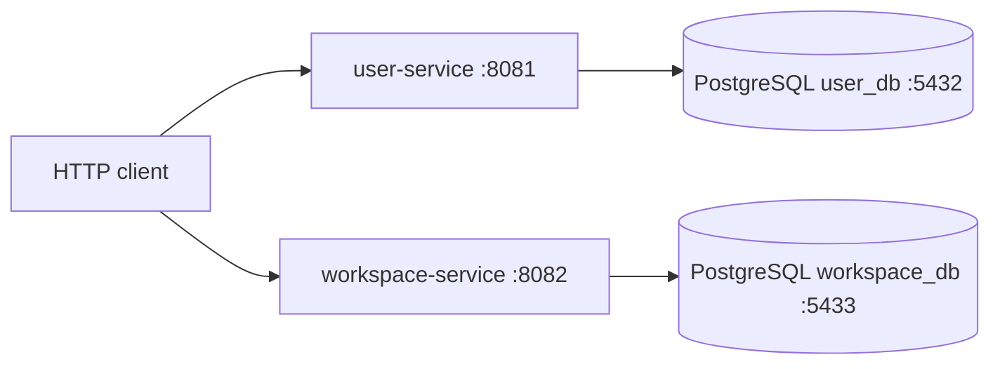
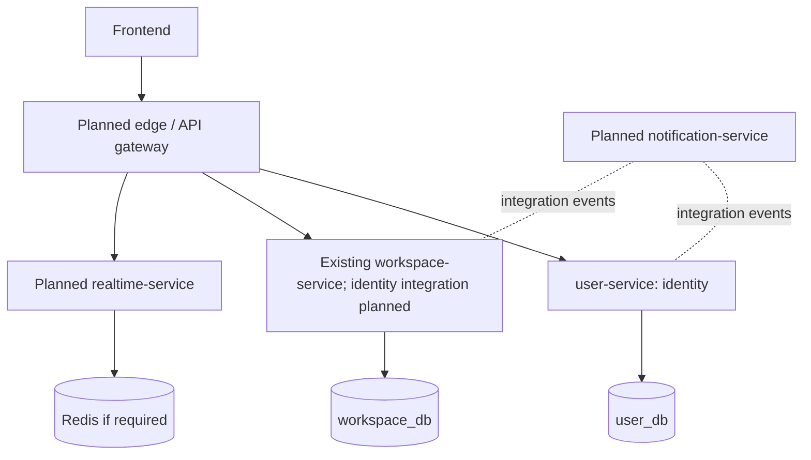

# Architecture

## Current architecture (source-verified)

The repository contains two independent Spring Boot services and no frontend, gateway, or service-to-service integration. Each owns a PostgreSQL database accessed through Spring Data JPA; Flyway manages schemas. Each local Compose file starts only its PostgreSQL instance.

Evidence: both services' Maven files, application configuration, Compose files, controllers and migrations. Service details: [[SERVICE-CATALOG]], [user-service architecture](../../services/user-service/docs/context/ARCHITECTURE.md) and [workspace context](../../services/workspace-service/docs/context/INDEX.md).

| Component | Current implementation |
| --- | --- |
| Service | `user-service`, REST MVC + Spring Security |
| Persistence | PostgreSQL database `user_db`; JPA mappings validated against Flyway (`ddl-auto: validate`) |
| Service port | 8081 |
| Database local port | 5432 |
| Workspace service | Java 21 / Spring Boot 4.1.1, HTTP 8082, PostgreSQL workspace_db on local port 5433 |
| Workspace API/security | Create/list/get; membership-filtered reads; atomic OWNER creation. X-User-Id only in explicit local/test profiles; default/prod/production returns 401 without trusted provider. JWT integration planned. |
| Additional services / gateway / broker / Redis | None found beyond the two current services |
| CI/CD | No workflow/configuration found |
| Containers | PostgreSQL Compose service exists; application Dockerfile is placeholder (`top -b`) |

## Target direction (planned)

This is a direction, not deployed topology. Service names and database allocations are conceptual proposals from the product architecture brief.

Workspace create/read MVP now exists independently, without cross-service identity integration. Realtime/notification services, gateway, Redis and event links remain planned. See [[ROADMAP]], [[COMMUNICATION]], [[DATA-OWNERSHIP]] and [workspace context](../../services/workspace-service/docs/context/INDEX.md).

## Invariants for future changes

- Each service owns one clear business capability and its persistence model.
- Never read or modify another service's database directly.
- Keep inter-service APIs and event schemas explicit.
- Keep business logic in its owning service; isolate infrastructure behind useful boundaries where practical, without abstractions that have no current use.
- Add infrastructure only for a concrete requirement. Roadmap presence alone is not a dependency.
