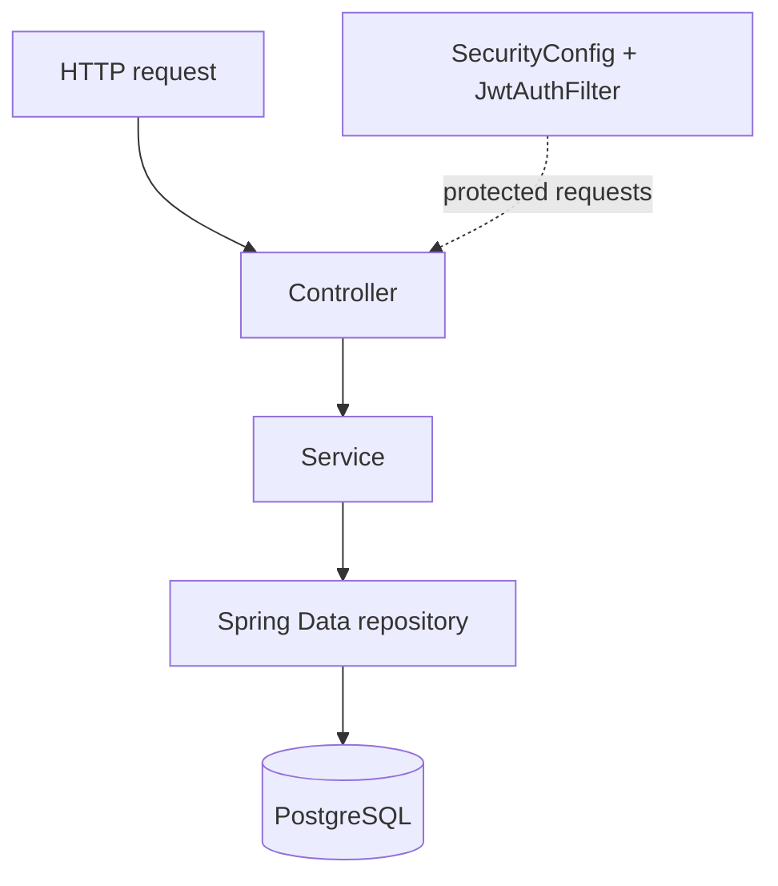

# user-service architecture

## Request and persistence path

Registration and auth paths may use several collaborators (password encoder, authentication manager, JWT service, refresh-token service). `UserController` reads the authenticated principal populated by the JWT filter.

## Important components

| Class | Responsibility | Depends on | Used by | Source |
| --- | --- | --- | --- | --- |
| `AuthController` | Register/login/logout/refresh HTTP routes | `AuthService`, request/response DTOs | HTTP clients | `src/main/java/com/notespace/userservice/controller/AuthController.java` |
| `UserController` | Current account endpoint | `UserService`, Spring `Authentication` | HTTP clients | `src/main/java/com/notespace/userservice/controller/UserController.java` |
| `AdminController` | Role-protected admin probe | Spring method security | HTTP clients | `src/main/java/com/notespace/userservice/controller/AdminController.java` |
| `AuthService` | Registration, credential authentication, token issuance and delegation | Repositories, encoder, `AuthenticationManager`, `JwtService`, `RefreshTokenService` | `AuthController` | `src/main/java/com/notespace/userservice/service/AuthService.java` |
| `RefreshTokenService` | Create/hash/verify/rotate/revoke refresh tokens | Both repositories | `AuthService` | `src/main/java/com/notespace/userservice/service/RefreshTokenService.java` |
| `UserService` | Resolve current user by email and map response | `AuthRepository` | `UserController` | `src/main/java/com/notespace/userservice/service/UserService.java` |
| `AuthRepository` | User persistence and email/username lookups | `User` / JPA | Auth/user services and user-details service | `src/main/java/com/notespace/userservice/repository/AuthRepository.java` |
| `RefreshTokenRepository` | Refresh-token persistence and fetch token owner | `RefreshToken` / JPA | `RefreshTokenService` | `src/main/java/com/notespace/userservice/repository/RefreshTokenRepository.java` |
| `SecurityConfig` | Password encoder, authentication manager, route policy, method-security activation, filter placement | `JwtAuthFilter`, Spring Security | HTTP security chain and method security | `src/main/java/com/notespace/userservice/security/SecurityConfig.java` |
| `JwtAuthFilter` / `JwtService` | Parse bearer JWT and establish request authentication; sign and validate JWTs | `CustomUserDetailsService`, JJWT | Security chain / `AuthService` | `src/main/java/com/notespace/userservice/security/JwtAuthFilter.java`, `JwtService.java` |
| `GlobalExceptionHandler` | Map validation and selected auth exceptions to JSON | `ErrorResponse` | MVC exception handling | `src/main/java/com/notespace/userservice/exception/GlobalExceptionHandler.java` |

## Change impact

- User persistence change: `entity/User.java`, Flyway migration, `AuthRepository`, response mapping/services, and tests.
- Auth route or payload change: `AuthController`, DTO constraints/shapes, `AuthService`, API documentation, tests, and potentially security policy.
- Token lifecycle change: `AuthService`, `RefreshTokenService`, `JwtService`/filter, `RefreshToken` migration/mapping, security docs, tests.
- Role/access change: `Role`, `CustomUserDetailsService`, `SecurityConfig`/method security, migrations, tests.
- Error contract change: exception classes, `GlobalExceptionHandler`, `ErrorResponse`, API docs, tests.
